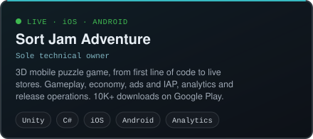
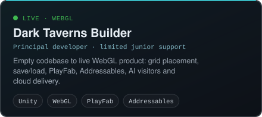
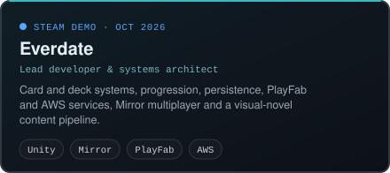
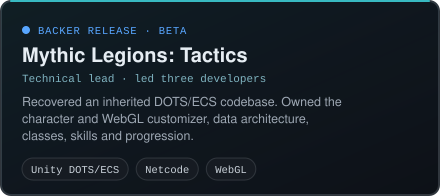
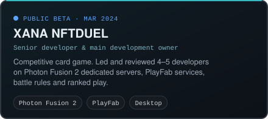
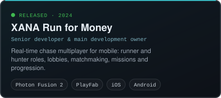
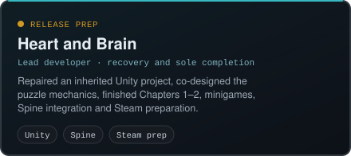
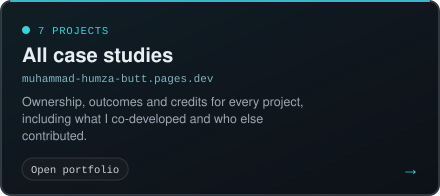
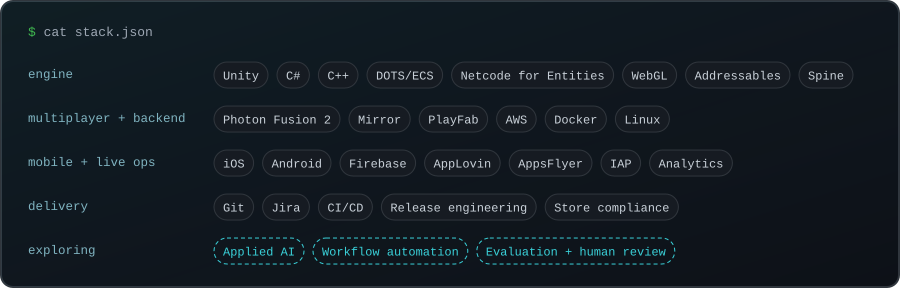

<p align="center">
  
</p>

<p align="center">
  <a href="https://muhammad-humza-butt.pages.dev"></a>
  <a href="https://www.linkedin.com/in/muhammad-humza-butt"></a>
  <a href="mailto:leonhumza@gmail.com"></a>
</p>

## ~/about

```ts
const humza = {
  name: "Muhammad Humza Butt",
  role: "Technical Product & Systems Architect",
  experience: "6+ years",
  location: "Remote",
  focus: [
    "Technical audits: keep, refactor or rebuild",
    "MVP architecture and phased development",
    "Backend, API and cloud-connected systems",
    "Multiplayer, mobile and WebGL game products",
  ],
  currently: "Extending into applied AI and workflow automation",
  contact: "leonhumza@gmail.com",
};
```

When a codebase is inherited, a build is stuck, or an MVP needs real architecture before more code is written, I audit the system, decide what to keep, refactor or rebuild, and build the critical parts through release.

## ~/projects

<p align="center">
  <a href="https://muhammad-humza-butt.pages.dev/work/sort-jam-adventure/"></a>
  <a href="https://muhammad-humza-butt.pages.dev/work/dark-taverns-builder/"></a>
  <a href="https://muhammad-humza-butt.pages.dev/work/everdate/"></a>
  <a href="https://muhammad-humza-butt.pages.dev/work/mythic-legions-tactics/"></a>
  <a href="https://muhammad-humza-butt.pages.dev/work/xana-nftduel/"></a>
  <a href="https://muhammad-humza-butt.pages.dev/work/xana-run-for-money/"></a>
  <a href="https://muhammad-humza-butt.pages.dev/work/heart-and-brain/"></a>
  <a href="https://muhammad-humza-butt.pages.dev"></a>
</p>

<sub>Game IP, art, licensing, production and publishing belong to their respective owners and teams. Each card shows my ownership: the technical implementation and delivery.</sub>

## ~/stack

<p align="center">
  
</p>

## ~/contact

For a technical audit, MVP, backend integration or game project, send a short brief with the current state of the project and the outcome you want.

<p>
  <a href="https://muhammad-humza-butt.pages.dev"></a>
  <a href="https://www.linkedin.com/in/muhammad-humza-butt"></a>
  <a href="mailto:leonhumza@gmail.com"></a>
</p>
