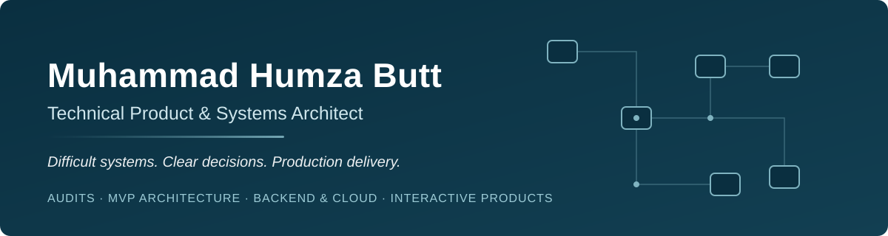

  

  <a href="https://muhammad-humza-butt.pages.dev"><b>Portfolio</b></a> &nbsp;·&nbsp;
  <a href="https://www.linkedin.com/in/muhammad-humza-butt">LinkedIn</a> &nbsp;·&nbsp;
  <a href="mailto:leonhumza@gmail.com">Email</a> &nbsp;·&nbsp;
  Remote

## About

I help founders, studios, and product teams make hard technical decisions and turn them into software that ships. When a codebase is inherited, a build is stuck, or an MVP needs real architecture before more code is written, I audit the system, decide what to keep, refactor, or rebuild, and build the critical parts through release.

I'm a hands-on technical product and systems architect with 6+ years across mobile, desktop, and WebGL. My foundation is games and interactive products, where real-time systems, backends, live operations, and release pipelines all have to work together. I'm also extending that experience into applied AI and workflow automation, with a focus on useful integrations, evaluation, and human review.

## What I do

- **Technical audits and architecture reviews**, including keep, refactor, or rebuild decisions
- **MVP discovery, system design, and phased development**
- **Backend, API, and cloud-connected architecture**, including multiplayer, dedicated servers, and PlayFab
- **Mobile monetization, analytics, attribution, and release pipelines**
- **Recovery of incomplete or inherited Unity projects**
- **Hands-on technical leadership** and development workflow automation

## Selected work

Each case study on the [portfolio](https://muhammad-humza-butt.pages.dev) states what I owned, what I co-developed, and who else contributed.

| Project | My role | What I built | |
|---|---|---|---|
| **Sort Jam Adventure** | Sole technical owner | A 3D mobile puzzle game from the first line of code through live iOS and Android releases: gameplay and level systems, progression and economy, ads and in-app purchases, analytics and attribution, store operations. 10K+ Google Play downloads. | [Case study](https://muhammad-humza-butt.pages.dev/work/sort-jam-adventure/) |
| **Dark Taverns Builder** | Principal developer and sole technical owner, with limited junior support | Built from an empty Unity codebase to a live WebGL product: grid placement, save/load, PlayFab, Addressables, AI visitors, inventory, cloud delivery. | [Case study](https://muhammad-humza-butt.pages.dev/work/dark-taverns-builder/) · [Live build](https://build.darktaverns.com/) |
| **Everdate** | Lead developer and systems architect | Card and deck systems, scheduling and progression, persistence, PlayFab and AWS services, Mirror multiplayer, a visual-novel pipeline, and cross-platform builds. Steam demo released October 2026. | [Case study](https://muhammad-humza-butt.pages.dev/work/everdate/) |
| **Mythic Legions: Tactics** | Technical lead | Led and reviewed three developers while recovering an inherited Unity DOTS/ECS codebase. Owned the character and WebGL customizer, data and content architecture, classes, skills, and progression. Backer release in beta form. | [Case study](https://muhammad-humza-butt.pages.dev/work/mythic-legions-tactics/) |
| **XANA NFTDUEL** | Senior developer and main development owner (contract) | Led and reviewed four to five developers on a competitive card game: Photon Fusion 2 dedicated servers, PlayFab services, battle rules, ranked play, desktop delivery. Public beta March 2024. | [Case study](https://muhammad-humza-butt.pages.dev/work/xana-nftduel/) |
| **XANA Run for Money** | Senior developer and main development owner (contract) | Role-based real-time chase multiplayer for mobile: runner and hunter gameplay, lobbies and matchmaking, missions, progression. iOS release September 2024, then Android. | [Case study](https://muhammad-humza-butt.pages.dev/work/xana-run-for-money/) |
| **Heart and Brain: The Video Game** | Lead developer, recovery and sole completion | Repaired an incomplete inherited Unity project, co-designed the puzzle mechanics, and completed Chapters 1–2, the minigames, Spine integration, and Steam preparation. | [Case study](https://muhammad-humza-butt.pages.dev/work/heart-and-brain/) |

Game IP, art, licensing, production, and publishing belong to their respective owners and teams. My ownership in each project is the technical implementation and delivery described above.

## Tools

| | |
|---|---|
| **Engine and languages** | Unity · C# · C++ · DOTS/ECS · Netcode for Entities · WebGL · Addressables · Spine |
| **Multiplayer and backend** | Photon Fusion 2 · Mirror · PlayFab · AWS · Docker · Linux |
| **Mobile and live operations** | iOS · Android · Firebase · AppLovin · AppsFlyer · in-app purchases · analytics · remote configuration |
| **Delivery** | Git · Jira · CI/CD · release engineering · store submission and compliance |

## Work with me

For a technical audit, MVP, backend integration, or game project, send a short brief with the current state of the project and the outcome you want.

**[Portfolio](https://muhammad-humza-butt.pages.dev)** &nbsp;·&nbsp; **[LinkedIn](https://www.linkedin.com/in/muhammad-humza-butt)** &nbsp;·&nbsp; **[Email](mailto:leonhumza@gmail.com)**
